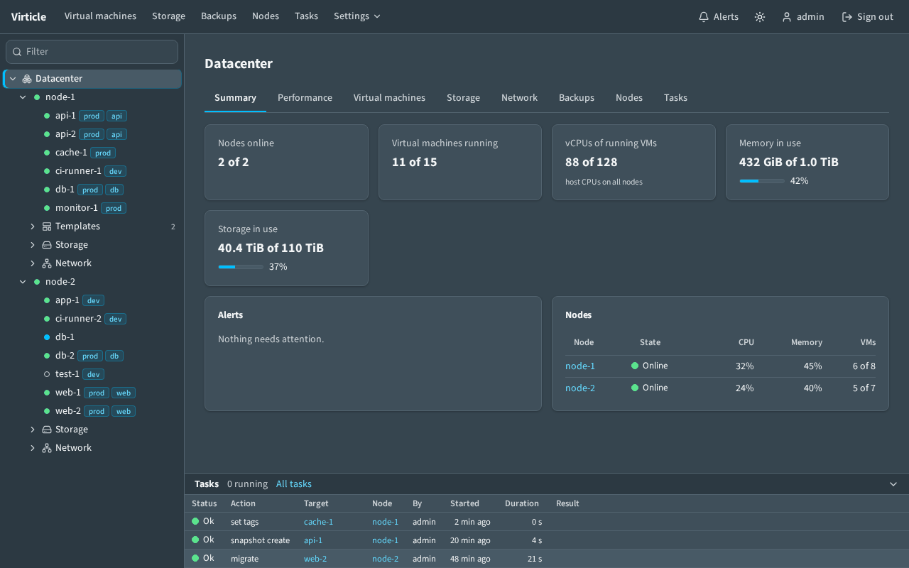
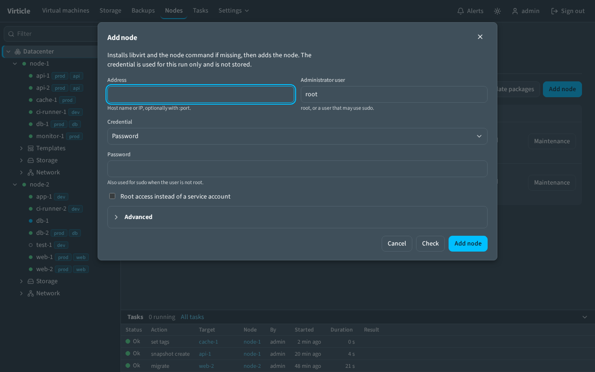
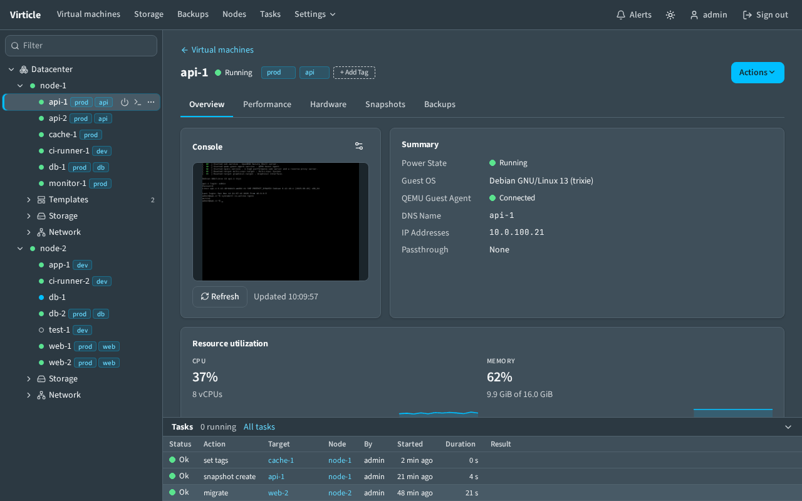
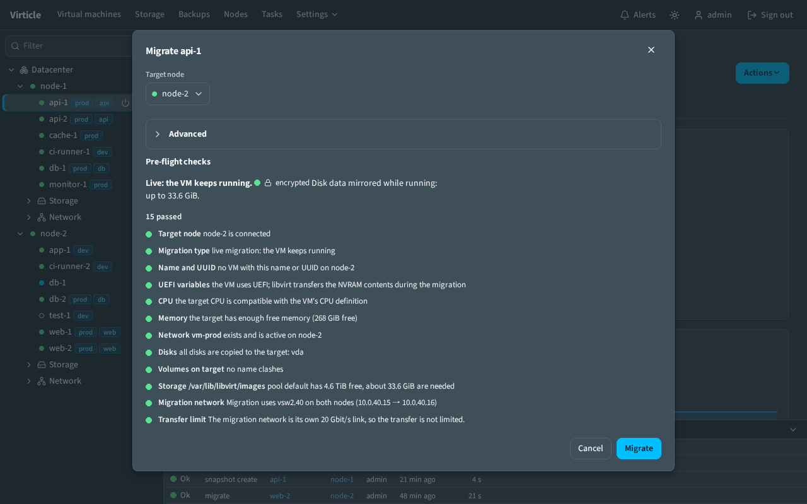

# Virticle

A web UI for KVM/QEMU/libvirt hosts. One program with the UI built in. It
manages your hosts (called "nodes") over SSH and installs no service on them.

Libvirt stays the source of truth. A VM made with `virsh` and a VM made in
Virticle look the same.

## What it does

| Area | Features |
| --- | --- |
| VMs | Create from cloud images, ISOs or templates. Clone, with user, password, SSH keys and packages for the clone: through cloud-init, or written into the disk of a Linux template without it. UEFI by default, Secure Boot, virtual TPM. Hot-plug hardware. Speed limit per network card. Edit the libvirt XML. |
| Consoles | Graphical (VNC) and serial, in the browser: inside the VM's Overview or in a tab of its own. |
| Migration and updates | Live and offline migration between nodes, with a list of pre-flight checks. Node maintenance and evacuation. A migration network per node, with an automatic limit on a shared link. Rolling updates: all nodes updated one at a time, their VMs moved away first. |
| Snapshots and backups | Manual or scheduled. Retention by rules (last, hourly, daily, weekly, monthly) with a preview of what is kept and the space it takes. Incremental backups that copy only what changed. Encryption with age. Verify by checksum. Restore, export, import. Backup and restore of the controller itself. |
| Replication | A copy of a VM on a standby node, kept up to date on a schedule, that starts with one click when the first node fails. Failover is by hand. |
| Storage | Pools, volumes, uploads, an image catalogue. Shared storage over NFS: VMs move between nodes without copying their disks. |
| Networks | One Network tab per datacenter and per node: switches, uplinks and the VMs on each network. NAT, isolated and bridged networks with start, stop, autostart, DHCP leases and reservations. Virtual switches with VLANs, several uplinks (failover or LACP), rollback if a change cuts the node off. Bridges made by hand with NetworkManager or netplan that fit are virtual switches too. Warnings when nodes differ. |
| Monitoring | Performance history for 7 days with charts, a `/metrics` endpoint for Prometheus, alerts, and notifications to Slack, Mattermost, Discord or a webhook. |
| Passthrough | PCI devices and GPUs. |
| Access | Users with three roles, two-step sign-in, sign-in through OIDC or LDAP, API tokens, audit log, task log. |
| HTTPS | Self-signed (the default), your own certificate, ACME, or behind a reverse proxy. |

## Quick start

Four steps: install the controller, create the administrator, add a node,
create a VM. On one machine the first three are two commands:
`sudo apt install virticle` and `sudo virticle setup`. The controller is the
machine that runs Virticle. It needs a Linux amd64 machine that can reach your
nodes over SSH.

### 1. Install the controller

Pick one.

| Way | Commands |
| --- | --- |
| Package repository (preferred) | Add the signed apt or dnf repository once, then `sudo apt install virticle` or `sudo dnf install virticle`. Steps in [docs/install.md](docs/install.md#install-from-the-package-repository). |
| Downloaded package, Debian or Ubuntu | `sudo apt-get install ./virticle_<version>_amd64.deb` |
| Downloaded package, RHEL family | `sudo dnf install ./virticle-<version>-1.x86_64.rpm` |
| Container | `docker compose up -d --build` |
| From source (needs Go and Node.js) | `make build` then `./bin/virticle -data ./data` |

Download packages from
[Releases](https://github.com/jacobanthonyroeder/virticle/releases). A package runs a
systemd service that serves HTTPS with a self-signed certificate on port 8463
of all interfaces. It does not touch the firewall: run `sudo virticle setup`
once. It asks which address and port to use (Enter keeps the defaults), asks
before it opens the port in firewalld or ufw, creates the administrator, offers
to add this machine as a node, and prints the address to open. Scripts pass
`--admin NAME --admin-password-file FILE --node`.
The container serves the same on port 8463 (compose.yaml publishes it on
`127.0.0.1`). More in [docs/install.md](docs/install.md).

### 2. Create the administrator

`sudo virticle setup` asks for the name and password on a terminal. Otherwise:

1. Open the address that `sudo virticle setup` printed, `https://<address>:8463`
   (the journal says the same: `journalctl -u virticle`). Your browser warns
   about the self-signed certificate. A source build started by hand in a data
   directory without users behaves the same.
2. Choose a user name and a password of at least 10 characters.

### 3. Add a node

A node is a Linux host that meets [Supported systems](#supported-systems).
Adding a node prepares it: libvirt, QEMU and a small
node command are installed and the access the controller needs is set up.
Nothing on the host is removed. A host that already runs libvirt is prepared
the same way, and its networks, pools and VMs stay as they are.

**From a shell** on the controller's machine:

    sudo virticle node add root@192.0.2.11    # another machine; asks for its password once
    sudo virticle node add                    # this machine (or answer yes in setup)
    sudo virticle status                      # the nodes, and what needs attention

The administrator login (root, or a user that may use sudo) is used once and
not stored. SSH must run on the host, also on the controller's own machine
(`sudo systemctl enable --now sshd`). The running controller shows the node at
once.

**In the browser.** Open **Nodes**, then **Add node**. Enter the address and
an administrator login for the host. **Check** shows what would change and
changes nothing; **Add node** prepares the host and adds it. While there are no
nodes, the **Datacenter** page also offers **Set up this machine as a node**.

The controller signs in to the node as the account `virticle-node`, which may
run the node command as root through one sudo rule and nothing else.
**Root access instead of a service account** (`--root`) is the alternative.
Details are in [docs/install-node.md](docs/install-node.md).

### 4. Create a VM

1. Open **Storage**, select a pool, choose **Image catalogue** and download a
   cloud image.
2. Open **Virtual machines**, then **New VM**. Set the name, node, **Disk
   image**, CPU, memory and network.
3. Open the VM. The **Console** card on its **Overview** opens the console.

## Supported systems

A node needs:

- libvirt 11.0 or newer and QEMU 10.0 or newer, from the distribution's own
  repositories
- x86-64 with hardware virtualisation (arm64 is not tested)
- systemd

| Node system | libvirt, QEMU | Status |
| --- | --- | --- |
| Debian 13 | 11.3, 10.0 | Tested |
| Rocky Linux 10 | 11.10, 10.1 | Tested |
| Any other distribution that ships libvirt 11.0 and QEMU 10.0 or newer | 11.0 or newer, 10.0 or newer | Accepted, not tested |
| Older releases, for example Debian 12 (libvirt 9.0, QEMU 7.2) and Ubuntu 24.04 LTS (libvirt 10.0, QEMU 8.2) | Below the minimum | Refused |

Virticle checks the versions and has no setting to skip the check:

- **Add node** refuses a host that is too old, and a host whose repositories
  would install versions that are too old. It changes nothing on the host.
- A node that is already added and has older software shows as offline, with
  the reason. It is not managed. After the node is upgraded, it comes back by
  itself.

## Everyday use

| To do this | Do this |
| --- | --- |
| Find a node or VM | Use the tree on the left. Drag its edge to resize. |
| See what happened | Look at the **Tasks** panel at the bottom. Every action shows progress and result. Long actions run in the background; the **x** next to a running one stops it. |
| Read a status | A coloured dot and the state name: green is good (Running, Ok), amber a warning, red a failure (Offline, Error), grey off. |
| Move a VM | **Actions > Migrate**. The pre-flight list says what blocks the move. |
| See how a VM was doing | The **Performance** tab of the VM or node. |
| Change the web address, certificate or port | **Settings > Web access** (administrator). A change you do not confirm is undone after 60 seconds. |
| Update packages | **Nodes > Update packages**. The plan is shown first. |
| Keep a standby copy of a VM | The VM's **Actions** menu, **Replication**. |
| Back up the controller | **Settings > Controller backup**, or `sudo virticle backup`. |

Live migration is coordinated by the controller. Memory and disk data go
directly from node to node. When a migration or restore has to copy files,
they also go from node to node, with a key that the controller sets up. That
key can only deliver a new file into a storage pool. You set up nothing by
hand.

## Upgrading

Upgrade the package, then prepare every node again (the node command has a new
version; **Nodes > Update Virticle on nodes** does all of them). Never let two controllers of
different versions manage the same nodes. Nodes below libvirt 11.0 and QEMU 10.0
are not managed. Steps for 0.4.x to 0.5.0, and for older versions, are in
[docs/install.md](docs/install.md#upgrading).

## Documentation

| If you want to | Read |
| --- | --- |
| Use the UI, with screenshots, and fix common problems | [docs/user-guide.md](docs/user-guide.md) |
| Install, upgrade, roll back, uninstall | [docs/install.md](docs/install.md) |
| Prepare a node, see what is installed on it, audit the node command | [docs/install-node.md](docs/install-node.md) |
| Back up the controller, restore it, move it, recover without a backup | [docs/controller-backup.md](docs/controller-backup.md) |
| Set up HTTPS, ACME or a reverse proxy | [docs/web-tls.md](docs/web-tls.md) |
| Two-step sign-in, sign-in with an identity provider (OIDC) or a directory (LDAP, Active Directory) | [docs/sign-in.md](docs/sign-in.md) |
| Feed Prometheus or Grafana | [docs/metrics.md](docs/metrics.md) |
| Look up commands, flags, roles, API tokens, data, schedules, limits | [docs/reference.md](docs/reference.md) |
| Build, test, release | [docs/development.md](docs/development.md) |
| See what is done, untested and planned | [ROADMAP.md](ROADMAP.md) |

## Contributing and security

- Bugs and ideas: open an issue. Code: see [CONTRIBUTING.md](CONTRIBUTING.md).
- Vulnerabilities: report privately, see [SECURITY.md](SECURITY.md).

## Status

Early release. Tested: a controller on Linux amd64, and nodes on Debian 13
and Rocky Linux 10, each in both access modes. Nodes need libvirt 11.0 and
QEMU 10.0 or newer; older systems are refused (see
[Supported systems](#supported-systems)).

Not tested: arm64, ACME certificate issuance, LACP against a real switch,
sign-in with identity providers other than the test provider, and virtual
switches on nodes that use ifupdown (refused) or plain systemd-networkd. A
Windows 11 guest with BitLocker and TPM 2.0 came up without its recovery key
after a failover (Rocky Linux nodes) and after backup, verify and restore
(plain, encrypted incremental and encrypted offline; on the same node and on
another node). There is no automatic failover. A
Debian node and a RHEL-family node cannot exchange VMs. The files on the
Releases page are not signed (the package repository is). No container image
is published.

## Licence

[Apache License 2.0](LICENSE). Third-party notices are in [NOTICE](NOTICE).

Created with the assistance of LLM coding tools.
